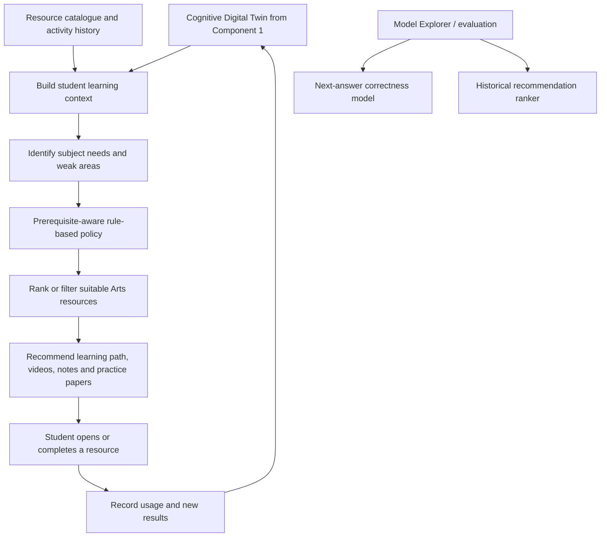

# Component 2: Personalized Learning and Recommendation Engine

**Research area:** Recommendation Systems  

## 1. Objective

Develop a recommendation engine that uses a student's Cognitive Digital Twin and learning activity to suggest relevant learning materials, quizzes, practice papers, and learning paths.

## 2. Main inputs and data

### From Component 1

- Student learning profile
- Strong and weak subjects
- Preferred learning style
- Learning progress
- Engagement level

### Learning activity and feedback

- Quiz and practice-paper results
- Lesson completion
- Resource usage
- Previously accessed resources
- Optional student feedback or ratings for recommendations

The system should also record whether recommended materials are opened or completed so that recommendations can be reviewed over time.

## 3. Component flow

## 4. Models and algorithms

### A. EdNet-trained Logistic Regression — next-answer correctness

- **Purpose:** Estimate the probability that a student will answer a question correctly, using EdNet-compatible question/history features.
- **Algorithm:** Logistic Regression, a supervised classification model that can estimate a probability.
- **Training-data context:** EdNet-related data.
- **Current limitation:** The project document states that this model has **not been validated on local A/L Arts questions**. It should not be presented as a proven predictor for the target student population.

### B. StandardScaler + Logistic Regression — historical recommendation ranker

- **Purpose:** Score or rank candidate recommendations using the features expected by the ranker.
- **Algorithm:** StandardScaler for feature scaling, followed by Logistic Regression.
- **Training-data context:** Synthetic/simulation data, according to the project document.
- **Current limitation:** The document notes that the ranker's topic vocabulary is not compatible with the current Arts catalogue. Therefore, it is **not used directly for canonical student-facing Arts recommendations**.

### C. Prerequisite-aware rule-based recommendation policy

- **Purpose:** Generate the current student-facing Arts resource recommendations.
- **Approach:** Rules use the student's needs and available resource information to filter or select suitable materials, taking prerequisites into account.
- **Why it is used:** It supports the current Arts catalogue without relying on the incompatible historical ranker's topic vocabulary.
- **Important distinction:** These recommendations are currently rule-based; they should not be described as being generated by the trained Logistic Regression ranker.

## 5. Dependencies

- Component 1 Cognitive Digital Twin and its subject/weak-area information
- Curated Arts learning-resource catalogue
- Resource metadata, such as subject, topic, type, and prerequisite information
- Quiz and practice-paper results
- Resource usage and completion tracking
- Optional student feedback
- Feature preparation compatible with any model used for evaluation

## 6. Outputs

- Personalized learning path
- Recommended videos, notes, and PDFs
- Adaptive quiz suggestions
- Recommended practice papers
- Resource recommendations that reflect subject needs and prerequisites

## 7. Validation and evaluation ideas

- Ask teachers to review whether recommendations are relevant to the selected topic.
- Measure whether students open and complete recommended resources.
- Compare recommendations with student feedback.
- Check whether prerequisites are respected.
- Evaluate next-answer correctness separately from recommendation quality.
- Test the models against local Arts questions and catalogue data before making claims about local predictive performance.

---
