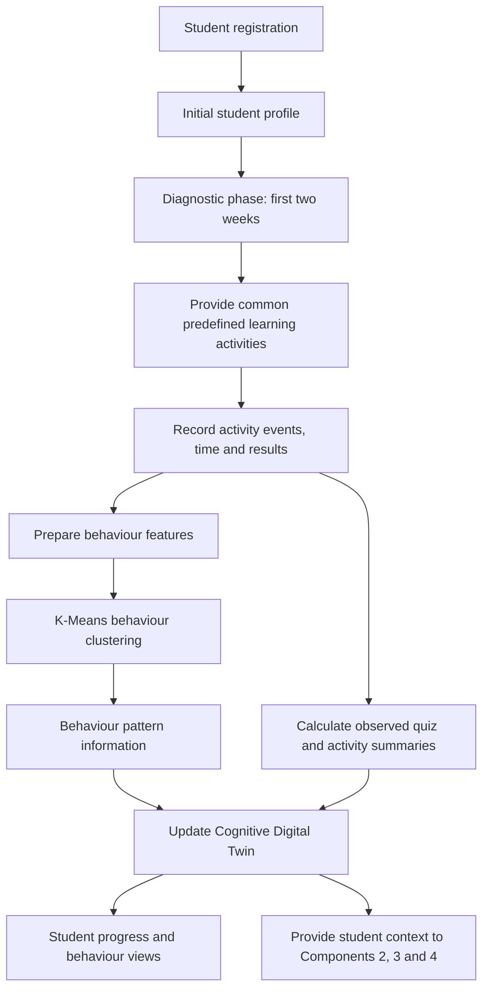

# Component 1: Student Behaviour Analysis and Cognitive Digital Twin

**Research area:** Learning Behaviour Analytics and Digital Twin  

## 1. Objective

Develop a Student Behaviour Analysis system that continuously analyses learning activities and maintains a Cognitive Digital Twin for each A/L Arts student. The twin represents the student's learning profile, preferences, progress, and observed behaviour to support personalization by other components.

## 2. Main inputs and data

### Initial registration data

- Student ID and name
- Age and school
- A/L Arts subjects
- Target examination year
- Learning goals
- Preferred learning style, such as videos, notes, or practice papers

### Learning behaviour data

- Lesson completion
- Time spent on lessons
- Quiz marks and attempts
- Practice-paper and assignment results
- Learning resource usage, including videos, notes, and PDFs
- Number of completed learning activities
- AI chatbot interactions
- Weekly learning progress

### Data collection approach

The platform collects basic profile information during registration and records learning activity events while students use the system. Each event may include a student identifier, resource or activity identifier, timestamp, duration, result, and completion status where applicable.

## 3. Component flow

### Cold-start and diagnostic phase

At the beginning, the platform has limited behavioural information for a newly registered student. The project design uses an initial profile and a **two-week diagnostic phase** with common, predefined learning activities. The platform records activity and performance information during this phase. This information can then help create a more individualized profile.

The two-week period is a project design choice; it should be evaluated to determine whether it provides enough information for reliable personalization.

## 4. Models and algorithms

### OULAD-trained K-Means clustering

- **Purpose:** Group compatible student activity features into behaviour clusters.
- **Algorithm:** K-Means, an unsupervised clustering algorithm.
- **Training-data context:** The project document describes the model as trained using OULAD-related data.
- **Use:** Explore patterns in behaviour features and make cluster information available for analysis.
- **Important distinction:** K-Means cluster predictions are separate from the student's actual quiz marks and attempt summaries.

### Observed activity-summary calculations

The system calculates summaries such as marks, attempts, and topic-level progress from saved database records. These are **observed data summaries**, not K-Means predictions.

## 5. Dependencies

- Student registration and profile management
- Learning platform activity/event logging
- Quiz and practice-paper result storage
- Learning resource usage tracking
- Database access to student activity history
- Feature preparation compatible with the clustering model
- Integration interfaces for Components 2, 3, and 4

## 6. Outputs

- Cognitive Digital Twin profile
- Student behaviour report
- Engagement score
- Subject/topic-level activity and performance summaries
- Behaviour cluster information for supported analysis

## 7. Validation and evaluation ideas

- Check whether activity events are recorded accurately.
- Verify that concurrent quiz submissions do not lose or duplicate attempts.
- Test how the twin changes when new activity is recorded.
- Check missing, incomplete, and inconsistent activity data.
- Evaluate whether behaviour clusters are meaningful for the local A/L Arts context.
- Validate any engagement score against a clearly defined and documented formula.

---
