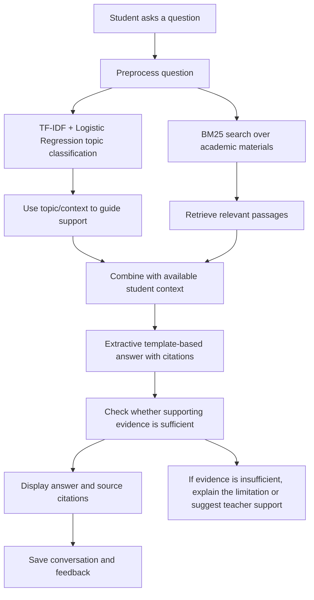
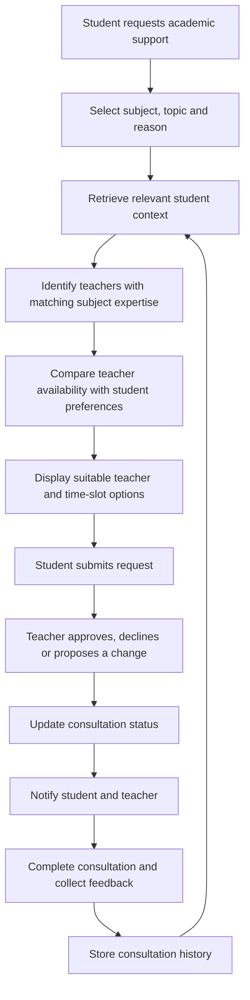
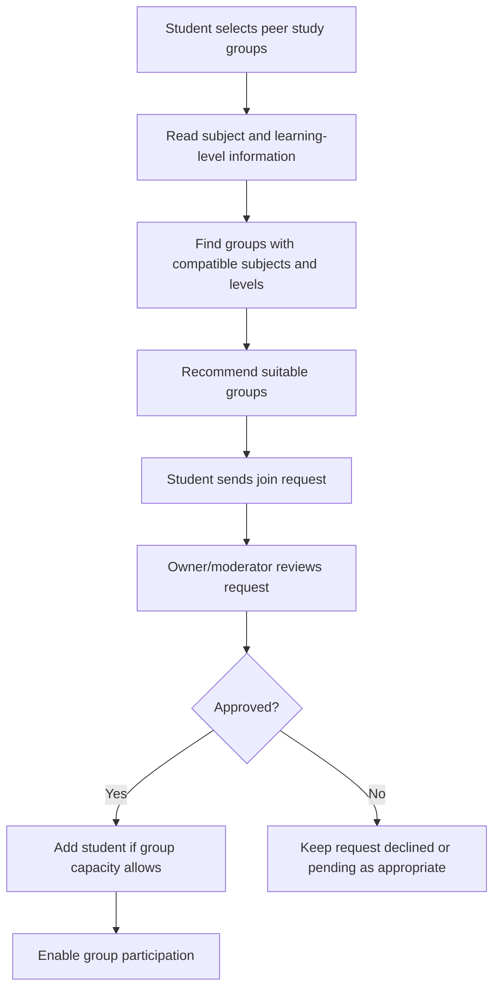

# Component 4: Context-Aware AI Academic Companion and Consultation Management

**Research area:** NLP, Conversational AI, Intelligent Academic Support, and Consultation Management  

This component contains two main academic-support features and a peer study-group workflow.

## Part A: Context-Aware AI Academic Companion

### 1. Objective

Develop a text-based academic assistant that answers student questions using relevant learning materials and the student's available academic context. It should recommend resources, retain conversation history, and identify cases where teacher support may be needed.

### 2. Main inputs and data

- Student questions
- Previous chat history
- Course materials, including PDFs, slides, and lecture notes
- Frequently Asked Questions
- Cognitive Digital Twin profile from Component 1
- Lecturer-provided knowledge base
- Student feedback on AI responses

### 3. AI Companion flow

### 4. Models and algorithms

#### TF-IDF + Logistic Regression — topic classification

- **Purpose:** Classify the student's text into one of the predefined topic classes.
- **TF-IDF:** Converts text into numerical features based on term importance.
- **Logistic Regression:** Predicts the topic class using the prepared text features.
- **Use:** Supports the topic-classification endpoint and Teacher Model Explorer described in the project document.

#### BM25 — information retrieval

- **Purpose:** Search the domain knowledge base for passages relevant to the student's question.
- **Algorithm:** BM25 ranks candidate documents or passages using query-term relevance.
- **Use:** Retrieves supporting content from available academic materials.

#### Extractive template-based answer generation

- **Purpose:** Assemble an answer from retrieved passages and provide citations to supporting materials.
- **Approach:** Uses retrieved evidence in a predefined answer template rather than generating unrestricted text with a live generative model.
- **Important limitation:** The project document states that a live generative LLM is **not currently configured**. The feature should therefore be described as retrieval-based, extractive/template-driven academic assistance, not as a fully generative AI chatbot.

### 5. Dependencies

- Course-material upload and knowledge-base processing
- Text preprocessing and topic-classification model
- BM25 index over approved academic content
- Citation/source metadata for retrieved passages
- Component 1 Cognitive Digital Twin, where relevant context is available
- Conversation-history storage
- Student feedback collection
- A clear insufficient-evidence response and teacher-escalation route

### 6. Outputs

- Context-aware academic answers
- Citations to retrieved learning materials
- Personalized academic guidance
- Relevant learning-resource suggestions
- Conversation history
- Identified academic support requirements

---

## Part B: Teacher–Student Consultation Management

### 1. Objective

Provide a structured way for students to request academic consultations and find suitable teachers based on subject expertise, the student's learning needs, and teacher availability.

### 2. Main inputs and data

- Student profile and subjects
- Learning progress and weak areas from the Cognitive Digital Twin
- Academic risk indicators, where available
- Consultation reason and problem description
- Preferred consultation date and time
- Teacher subject expertise
- Teacher availability
- Previous consultation records and status
- Student feedback after consultation

### 3. Consultation flow

### 4. Models and algorithms

The project document describes this workflow as using **rule-based matching and database operations**, rather than a trained teacher-recommendation model.

Matching can consider:

1. Subject/topic match between the student's need and the teacher's expertise.
2. Availability of a teacher's time slots.
3. The student's preferred date and time.
4. Consultation status and booking conflicts.

The system should only show slots that are available and should prevent conflicting bookings. These rules make the workflow more context-aware than a basic appointment list.

### 5. Dependencies

- Student profile and Cognitive Digital Twin information from Component 1
- Teacher profiles and subject expertise
- Teacher availability calendar
- Consultation request and appointment database
- Booking validation and status transitions
- Notification mechanism
- Feedback and consultation-history storage

### 6. Outputs

- Teacher availability calendar
- Consultation requests
- Recommended teachers and time slots
- Confirmed, rescheduled, or cancelled appointments
- Consultation notifications
- Consultation history and feedback
- Teacher–student consultation reports

---

## Part C: Student–Student Peer Study Groups

### 1. Objective

Help students discover relevant peer study groups based on their current subjects and learning level, and allow group owners or moderators to manage joining requests.

### 2. Peer-group flow

### 3. Algorithms and logic

- **Rule-based group matching:** Compare student subjects and available learning-level information with group metadata.
- **Approval workflow:** Group owners/moderators/admins approve or reject join requests.
- **Validation rules:** Check duplicate requests and group capacity before accepting a request.
- **Database operations:** Store groups, membership requests, decisions, and membership status.

The peer-group workflow is rule-based; the project document does not specify a trained peer-matching model.

### 4. Dependencies

- Student subjects and learning-level information
- Peer study-group records
- Group capacity and membership status
- Join-request and approval records
- Group owner/moderator permissions

### 5. Outputs
- Recommended peer study groups
- Join requests and approval status
- Group membership records
- Group participation features supported by the implementation
