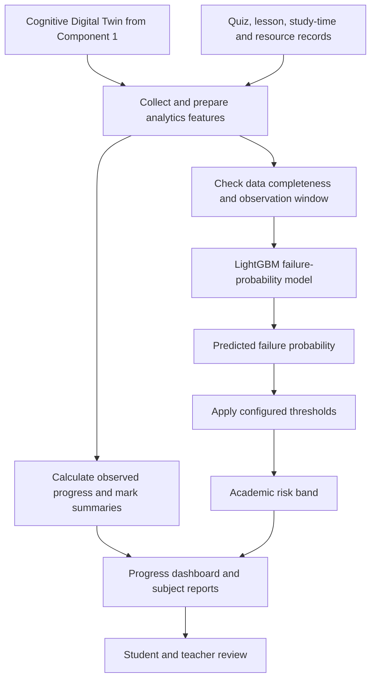

# Component 3: Academic Risk and Learning Progress Analytics

**Research area:** Learning Progress Analytics, Academic Risk Analytics, and Data Visualization  

## 1. Objective

Develop an analytics system that monitors student learning progress, identifies possible academic risk using performance and activity trends, and presents the results through an interactive dashboard for students and teachers.

## 2. Main inputs and data

- Cognitive Digital Twin profile from Component 1
- Quiz and practice-paper results
- Lesson completion
- Study time
- Learning consistency
- Subject-wise progress
- Learning resource usage
- AI chatbot interactions
- Weekly learning activities

The system combines performance information with learning activity trends rather than relying only on a single mark.

## 3. Component flow

## 4. Models and algorithms

### OULAD-trained LightGBM Classifier

- **Purpose:** Estimate failure probability for an outcome classification task.
- **Algorithm:** LightGBM, a gradient-boosting decision-tree framework.
- **Training-data context:** OULAD-related public data.
- **Target in the project document:** Fail versus Pass/Distinction; withdrawn records are excluded from this classification task.
- **Risk band:** Configured thresholds are applied to the predicted probability to assign a risk band.
- **Current limitation:** The public-data model has **not yet been validated for predicting failure in local A/L examinations**.

### Rule-based risk-band mapping

The model produces a probability. Configured thresholds convert that probability into a risk band. Thresholds should be documented and evaluated rather than selected without justification.

### Observed progress calculations

Marks, quiz attempts, and other progress summaries shown on the dashboard are calculated from database records. These values are **not AI predictions**. The system should make the distinction clear in its interface.

### Data completeness checks

If the observation window is incomplete or required features are missing, the system should display an appropriate data-status message instead of implying that the prediction is reliable.

## 5. Dependencies

- Component 1 Cognitive Digital Twin
- Quiz, practice-paper, lesson, and resource-usage records
- Consistent feature definitions for the LightGBM model
- Configured risk thresholds
- Data completeness and observation-window checks
- Dashboard charts and report generation
- Access control for student and teacher views

## 6. Outputs

- Academic risk indicator
- Learning progress dashboard
- Subject-wise progress report
- Performance analytics report
- Progress trends and data-completeness status

## 7. Validation and evaluation ideas

- Evaluate classification performance using appropriate metrics such as precision, recall, F1-score, and ROC-AUC where suitable.
- Check calibration of predicted probabilities.
- Review risk thresholds with educators.
- Test missing-data and incomplete-observation scenarios.
- Compare model performance with local A/L Arts data before real-world use.
- Confirm that dashboard summaries match stored quiz and activity records.
- Check whether risk indicators are useful to teachers without causing unfair labeling.
