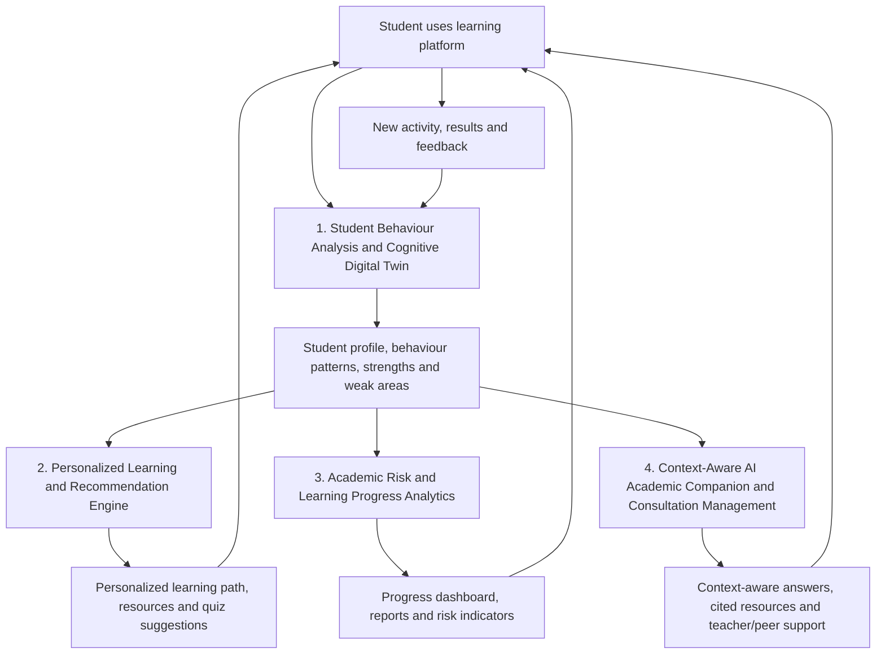
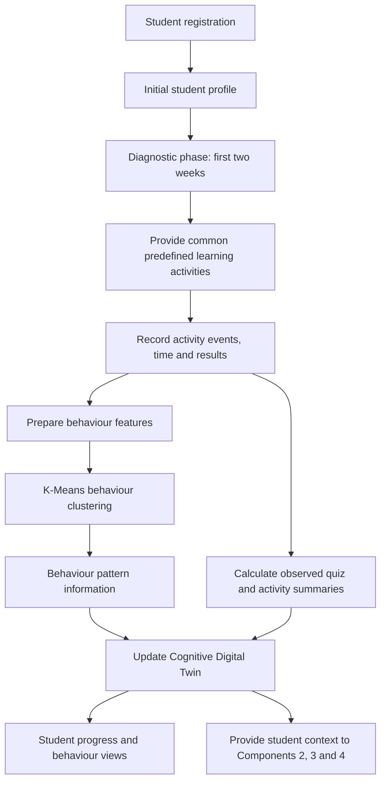
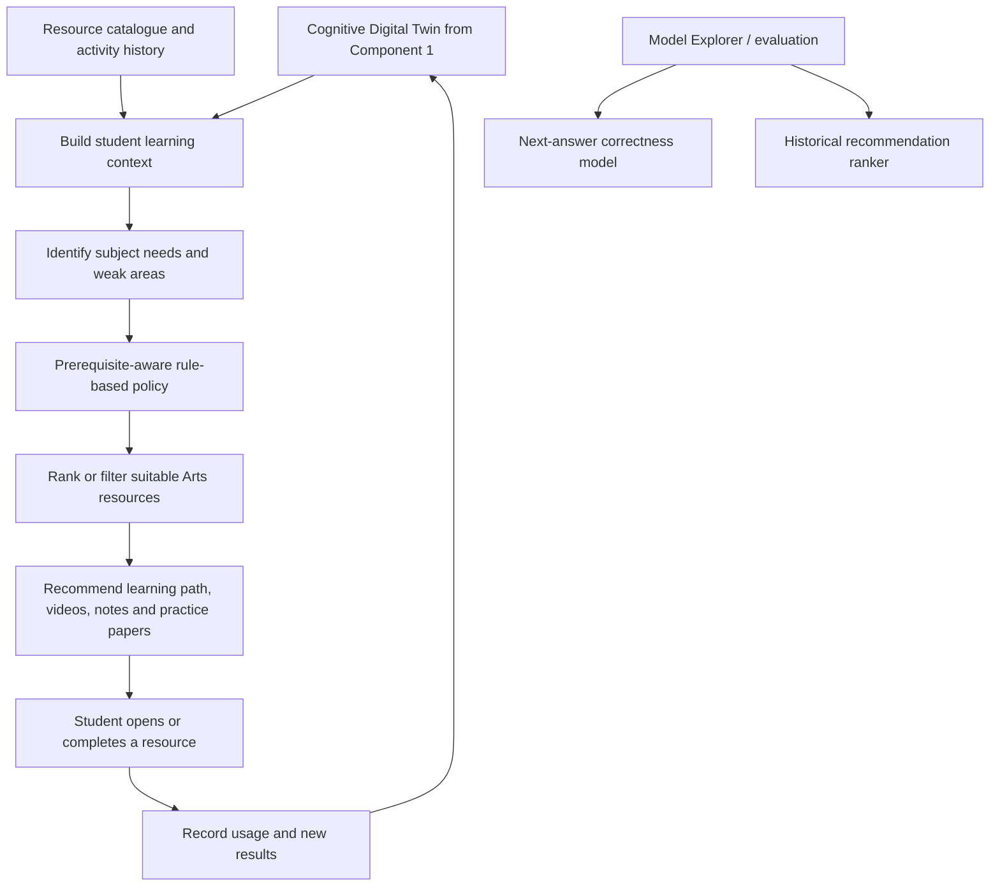
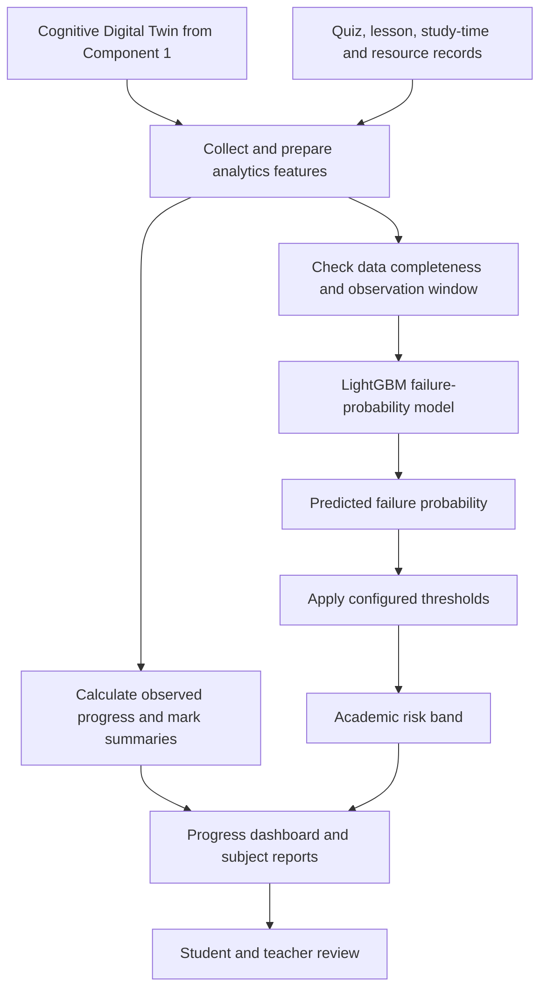
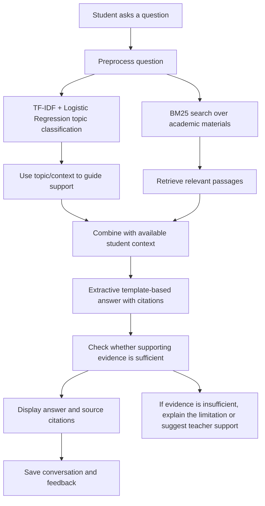
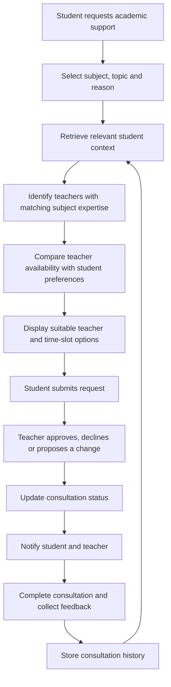
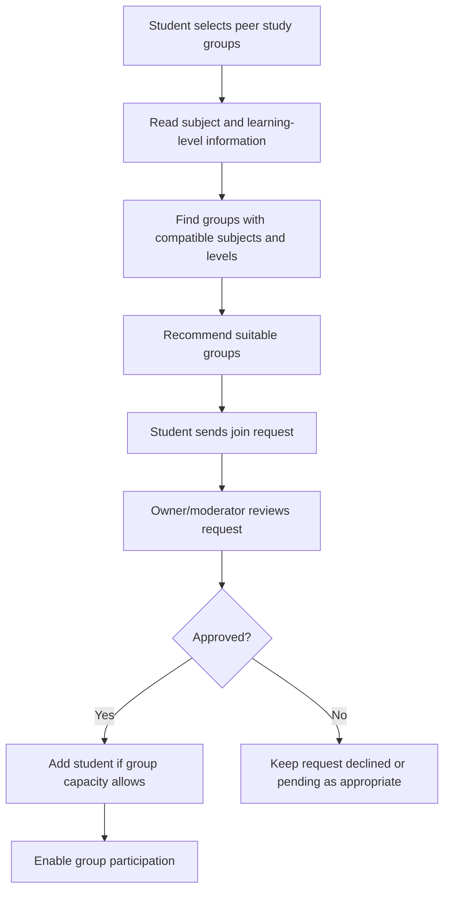
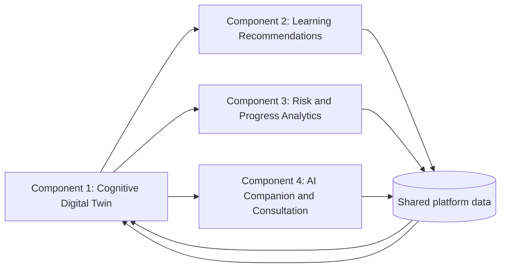

# AI-Powered Cognitive Digital Twin for Intelligent Personalized Learning

An AI-supported learning platform designed to help **A/L Arts students** receive personalized learning materials, understand their academic progress, identify potential academic risks, and access AI or teacher support when needed.

The project is organized into four connected research components. Each component has a specific responsibility and exchanges relevant information with the other components to support personalized learning.

> **Research note:** Some models described below were trained using public datasets or synthetic/simulation data. They are research prototypes and must be validated with local A/L Arts student data before being used for real academic decisions. A model prediction is not the same as an observed student result.

---

## System Overview

The platform aims to make learning support more personalized by combining student learning behaviour, resource recommendations, academic progress analytics, and contextual academic support.

### Main goals

- Model each student's learning behaviour over time.
- Recommend learning materials based on the student's profile and learning needs.
- Monitor subject-wise progress and highlight possible academic risks.
- Provide context-aware academic assistance and a structured route to teacher or peer support.
- Help students and teachers make better-informed learning decisions.

---

## Four Research Components

| Component | Main responsibility | Key outputs |
|---|---|---|
| **1. Student Behaviour Analysis & Cognitive Digital Twin** | Build and update a representation of each student's learning profile and behaviour. | Cognitive Digital Twin, behaviour report, engagement score |
| **2. Personalized Learning & Recommendation Engine** | Recommend suitable learning resources and learning activities. | Personalized learning path, videos/notes, adaptive quiz and practice-paper suggestions |
| **3. Academic Risk & Learning Progress Analytics** | Analyse progress and display possible academic risks. | Progress dashboard, subject-wise reports, academic risk indicator |
| **4. Context-Aware AI Academic Companion & Consultation Management** | Answer academic questions using relevant learning materials and connect students with suitable academic support. | Contextual answers with citations, resource suggestions, consultation appointments, peer study-group workflows |

---

# Component 1: Student Behaviour Analysis and Cognitive Digital Twin

**Research area:** Learning Behaviour Analytics and Digital Twin  
**Component owner:** Pawanya

## 1. Objective

Develop a Student Behaviour Analysis system that continuously analyses learning activities and maintains a Cognitive Digital Twin for each A/L Arts student. The twin represents the student's learning profile, preferences, progress, and observed behaviour to support personalization by other components.

## 2. Main inputs and data

### Initial registration data

- Student ID and name
- Age and school
- A/L Arts subjects
- Target examination year
- Learning goals
- Preferred learning style, such as videos, notes, or practice papers

### Learning behaviour data

- Lesson completion
- Time spent on lessons
- Quiz marks and attempts
- Practice-paper and assignment results
- Learning resource usage, including videos, notes, and PDFs
- Number of completed learning activities
- AI chatbot interactions
- Weekly learning progress

### Data collection approach

The platform collects basic profile information during registration and records learning activity events while students use the system. Each event may include a student identifier, resource or activity identifier, timestamp, duration, result, and completion status where applicable.

## 3. Component flow

### Cold-start and diagnostic phase

At the beginning, the platform has limited behavioural information for a newly registered student. The project design uses an initial profile and a **two-week diagnostic phase** with common, predefined learning activities. The platform records activity and performance information during this phase. This information can then help create a more individualized profile.

The two-week period is a project design choice; it should be evaluated to determine whether it provides enough information for reliable personalization.

## 4. Models and algorithms

### OULAD-trained K-Means clustering

- **Purpose:** Group compatible student activity features into behaviour clusters.
- **Algorithm:** K-Means, an unsupervised clustering algorithm.
- **Training-data context:** The project document describes the model as trained using OULAD-related data.
- **Use:** Explore patterns in behaviour features and make cluster information available for analysis.
- **Important distinction:** K-Means cluster predictions are separate from the student's actual quiz marks and attempt summaries.

### Observed activity-summary calculations

The system calculates summaries such as marks, attempts, and topic-level progress from saved database records. These are **observed data summaries**, not K-Means predictions.

## 5. Dependencies

- Student registration and profile management
- Learning platform activity/event logging
- Quiz and practice-paper result storage
- Learning resource usage tracking
- Database access to student activity history
- Feature preparation compatible with the clustering model
- Integration interfaces for Components 2, 3, and 4

## 6. Outputs

- Cognitive Digital Twin profile
- Student behaviour report
- Engagement score
- Subject/topic-level activity and performance summaries
- Behaviour cluster information for supported analysis

## 7. Validation and evaluation ideas

- Check whether activity events are recorded accurately.
- Verify that concurrent quiz submissions do not lose or duplicate attempts.
- Test how the twin changes when new activity is recorded.
- Check missing, incomplete, and inconsistent activity data.
- Evaluate whether behaviour clusters are meaningful for the local A/L Arts context.
- Validate any engagement score against a clearly defined and documented formula.

---

# Component 2: Personalized Learning and Recommendation Engine

**Research area:** Recommendation Systems  
**Component owner:** Mandira

## 1. Objective

Develop a recommendation engine that uses a student's Cognitive Digital Twin and learning activity to suggest relevant learning materials, quizzes, practice papers, and learning paths.

## 2. Main inputs and data

### From Component 1

- Student learning profile
- Strong and weak subjects
- Preferred learning style
- Learning progress
- Engagement level

### Learning activity and feedback

- Quiz and practice-paper results
- Lesson completion
- Resource usage
- Previously accessed resources
- Optional student feedback or ratings for recommendations

The system should also record whether recommended materials are opened or completed so that recommendations can be reviewed over time.

## 3. Component flow

## 4. Models and algorithms

### A. EdNet-trained Logistic Regression — next-answer correctness

- **Purpose:** Estimate the probability that a student will answer a question correctly, using EdNet-compatible question/history features.
- **Algorithm:** Logistic Regression, a supervised classification model that can estimate a probability.
- **Training-data context:** EdNet-related data.
- **Current limitation:** The project document states that this model has **not been validated on local A/L Arts questions**. It should not be presented as a proven predictor for the target student population.

### B. StandardScaler + Logistic Regression — historical recommendation ranker

- **Purpose:** Score or rank candidate recommendations using the features expected by the ranker.
- **Algorithm:** StandardScaler for feature scaling, followed by Logistic Regression.
- **Training-data context:** Synthetic/simulation data, according to the project document.
- **Current limitation:** The document notes that the ranker's topic vocabulary is not compatible with the current Arts catalogue. Therefore, it is **not used directly for canonical student-facing Arts recommendations**.

### C. Prerequisite-aware rule-based recommendation policy

- **Purpose:** Generate the current student-facing Arts resource recommendations.
- **Approach:** Rules use the student's needs and available resource information to filter or select suitable materials, taking prerequisites into account.
- **Why it is used:** It supports the current Arts catalogue without relying on the incompatible historical ranker's topic vocabulary.
- **Important distinction:** These recommendations are currently rule-based; they should not be described as being generated by the trained Logistic Regression ranker.

## 5. Dependencies

- Component 1 Cognitive Digital Twin and its subject/weak-area information
- Curated Arts learning-resource catalogue
- Resource metadata, such as subject, topic, type, and prerequisite information
- Quiz and practice-paper results
- Resource usage and completion tracking
- Optional student feedback
- Feature preparation compatible with any model used for evaluation

## 6. Outputs

- Personalized learning path
- Recommended videos, notes, and PDFs
- Adaptive quiz suggestions
- Recommended practice papers
- Resource recommendations that reflect subject needs and prerequisites

## 7. Validation and evaluation ideas

- Ask teachers to review whether recommendations are relevant to the selected topic.
- Measure whether students open and complete recommended resources.
- Compare recommendations with student feedback.
- Check whether prerequisites are respected.
- Evaluate next-answer correctness separately from recommendation quality.
- Test the models against local Arts questions and catalogue data before making claims about local predictive performance.

---

# Component 3: Academic Risk and Learning Progress Analytics

**Research area:** Learning Progress Analytics, Academic Risk Analytics, and Data Visualization  
**Component owner:** Sewmini

## 1. Objective

Develop an analytics system that monitors student learning progress, identifies possible academic risk using performance and activity trends, and presents the results through an interactive dashboard for students and teachers.

## 2. Main inputs and data

- Cognitive Digital Twin profile from Component 1
- Quiz and practice-paper results
- Lesson completion
- Study time
- Learning consistency
- Subject-wise progress
- Learning resource usage
- AI chatbot interactions
- Weekly learning activities

The system combines performance information with learning activity trends rather than relying only on a single mark.

## 3. Component flow

## 4. Models and algorithms

### OULAD-trained LightGBM Classifier

- **Purpose:** Estimate failure probability for an outcome classification task.
- **Algorithm:** LightGBM, a gradient-boosting decision-tree framework.
- **Training-data context:** OULAD-related public data.
- **Target in the project document:** Fail versus Pass/Distinction; withdrawn records are excluded from this classification task.
- **Risk band:** Configured thresholds are applied to the predicted probability to assign a risk band.
- **Current limitation:** The public-data model has **not yet been validated for predicting failure in local A/L examinations**.

### Rule-based risk-band mapping

The model produces a probability. Configured thresholds convert that probability into a risk band. Thresholds should be documented and evaluated rather than selected without justification.

### Observed progress calculations

Marks, quiz attempts, and other progress summaries shown on the dashboard are calculated from database records. These values are **not AI predictions**. The system should make the distinction clear in its interface.

### Data completeness checks

If the observation window is incomplete or required features are missing, the system should display an appropriate data-status message instead of implying that the prediction is reliable.

## 5. Dependencies

- Component 1 Cognitive Digital Twin
- Quiz, practice-paper, lesson, and resource-usage records
- Consistent feature definitions for the LightGBM model
- Configured risk thresholds
- Data completeness and observation-window checks
- Dashboard charts and report generation
- Access control for student and teacher views

## 6. Outputs

- Academic risk indicator
- Learning progress dashboard
- Subject-wise progress report
- Performance analytics report
- Progress trends and data-completeness status

## 7. Validation and evaluation ideas

- Evaluate classification performance using appropriate metrics such as precision, recall, F1-score, and ROC-AUC where suitable.
- Check calibration of predicted probabilities.
- Review risk thresholds with educators.
- Test missing-data and incomplete-observation scenarios.
- Compare model performance with local A/L Arts data before real-world use.
- Confirm that dashboard summaries match stored quiz and activity records.
- Check whether risk indicators are useful to teachers without causing unfair labeling.

---

# Component 4: Context-Aware AI Academic Companion and Consultation Management

**Research area:** NLP, Conversational AI, Intelligent Academic Support, and Consultation Management  
**Component owner:** Sanduni

This component contains two main academic-support features and a peer study-group workflow.

## Part A: Context-Aware AI Academic Companion

### 1. Objective

Develop a text-based academic assistant that answers student questions using relevant learning materials and the student's available academic context. It should recommend resources, retain conversation history, and identify cases where teacher support may be needed.

### 2. Main inputs and data

- Student questions
- Previous chat history
- Course materials, including PDFs, slides, and lecture notes
- Frequently Asked Questions
- Cognitive Digital Twin profile from Component 1
- Lecturer-provided knowledge base
- Student feedback on AI responses

### 3. AI Companion flow

### 4. Models and algorithms

#### TF-IDF + Logistic Regression — topic classification

- **Purpose:** Classify the student's text into one of the predefined topic classes.
- **TF-IDF:** Converts text into numerical features based on term importance.
- **Logistic Regression:** Predicts the topic class using the prepared text features.
- **Use:** Supports the topic-classification endpoint and Teacher Model Explorer described in the project document.

#### BM25 — information retrieval

- **Purpose:** Search the domain knowledge base for passages relevant to the student's question.
- **Algorithm:** BM25 ranks candidate documents or passages using query-term relevance.
- **Use:** Retrieves supporting content from available academic materials.

#### Extractive template-based answer generation

- **Purpose:** Assemble an answer from retrieved passages and provide citations to supporting materials.
- **Approach:** Uses retrieved evidence in a predefined answer template rather than generating unrestricted text with a live generative model.
- **Important limitation:** The project document states that a live generative LLM is **not currently configured**. The feature should therefore be described as retrieval-based, extractive/template-driven academic assistance, not as a fully generative AI chatbot.

### 5. Dependencies

- Course-material upload and knowledge-base processing
- Text preprocessing and topic-classification model
- BM25 index over approved academic content
- Citation/source metadata for retrieved passages
- Component 1 Cognitive Digital Twin, where relevant context is available
- Conversation-history storage
- Student feedback collection
- A clear insufficient-evidence response and teacher-escalation route

### 6. Outputs

- Context-aware academic answers
- Citations to retrieved learning materials
- Personalized academic guidance
- Relevant learning-resource suggestions
- Conversation history
- Identified academic support requirements

---

## Part B: Teacher–Student Consultation Management

### 1. Objective

Provide a structured way for students to request academic consultations and find suitable teachers based on subject expertise, the student's learning needs, and teacher availability.

### 2. Main inputs and data

- Student profile and subjects
- Learning progress and weak areas from the Cognitive Digital Twin
- Academic risk indicators, where available
- Consultation reason and problem description
- Preferred consultation date and time
- Teacher subject expertise
- Teacher availability
- Previous consultation records and status
- Student feedback after consultation

### 3. Consultation flow

### 4. Models and algorithms

The project document describes this workflow as using **rule-based matching and database operations**, rather than a trained teacher-recommendation model.

Matching can consider:

1. Subject/topic match between the student's need and the teacher's expertise.
2. Availability of a teacher's time slots.
3. The student's preferred date and time.
4. Consultation status and booking conflicts.

The system should only show slots that are available and should prevent conflicting bookings. These rules make the workflow more context-aware than a basic appointment list.

### 5. Dependencies

- Student profile and Cognitive Digital Twin information from Component 1
- Teacher profiles and subject expertise
- Teacher availability calendar
- Consultation request and appointment database
- Booking validation and status transitions
- Notification mechanism
- Feedback and consultation-history storage

### 6. Outputs

- Teacher availability calendar
- Consultation requests
- Recommended teachers and time slots
- Confirmed, rescheduled, or cancelled appointments
- Consultation notifications
- Consultation history and feedback
- Teacher–student consultation reports

---

## Part C: Student–Student Peer Study Groups

### 1. Objective

Help students discover relevant peer study groups based on their current subjects and learning level, and allow group owners or moderators to manage joining requests.

### 2. Peer-group flow

### 3. Algorithms and logic

- **Rule-based group matching:** Compare student subjects and available learning-level information with group metadata.
- **Approval workflow:** Group owners/moderators/admins approve or reject join requests.
- **Validation rules:** Check duplicate requests and group capacity before accepting a request.
- **Database operations:** Store groups, membership requests, decisions, and membership status.

The peer-group workflow is rule-based; the project document does not specify a trained peer-matching model.

### 4. Dependencies and outputs

**Dependencies**
- Student subjects and learning-level information
- Peer study-group records
- Group capacity and membership status
- Join-request and approval records
- Group owner/moderator permissions

**Outputs**
- Recommended peer study groups
- Join requests and approval status
- Group membership records
- Group participation features supported by the implementation

---

## Component Dependencies

The components are connected, but they have different responsibilities.

### Dependency details

| From | To | Information exchanged | Why it is needed |
|---|---|---|---|
| Component 1 | Component 2 | Profile, strengths/weaknesses, preferences, progress, engagement | To personalize learning-resource recommendations |
| Component 1 | Component 3 | Student context and learning behaviour | To support progress analysis and risk assessment |
| Component 1 | Component 4 | Relevant student context, weak areas, and learning history | To contextualize academic answers and support consultation matching |
| Component 2 | Shared platform data / Component 1 | Resource opens, completion, and learning activity | To record subsequent behaviour and support future updates |
| Component 3 | Component 4, where integrated | Academic-risk or weak-area information | To help identify students who may benefit from human support |
| Component 4 | Shared platform data / Component 1 | Chat activity, consultation history, and feedback where approved | To preserve support history and inform later analysis |

**Integration principle:** Components should use documented data contracts and shared identifiers. A component should not treat a prediction as a confirmed academic result.

---

### Example event flow

1. A student completes a quiz.
2. The quiz attempt and result are stored.
3. Component 1 uses the new activity to update relevant behaviour information.
4. Component 2 can use the latest student context to adjust resource suggestions.
5. Component 3 recalculates observed progress summaries and, when sufficient compatible features exist, can evaluate academic risk.
6. Component 4 may use relevant weak-area information to suggest resources or help the student request a teacher consultation.

---

## Data Privacy and Responsible Use

The platform processes student profiles, academic performance, learning activity, conversations, and consultation history. These data should be handled carefully.

- Collect only data needed for the stated learning purposes.
- Explain what data is collected and how it is used.
- Restrict student, teacher, and administrator access according to their roles.
- Protect data in transit and at rest where supported by the implementation.
- Avoid exposing personal student information in logs, screenshots, or public repository examples.
- Use anonymized or synthetic data in public demonstrations.
- Define retention and deletion procedures for student records.
- Keep teacher oversight in academic-risk and support decisions.
- Present risk outputs as indicators for review, not as definitive judgments.
- Obtain appropriate institutional permissions and consent before collecting real student data.

Do not commit real student records, credentials, API keys, private course documents, or environment files to GitHub.

---

## Future Improvements

- Validate models using appropriately collected and consented local A/L Arts data.
- Evaluate behaviour clusters and define interpretable student-facing descriptions.
- Improve resource metadata and prerequisite mapping for the Arts curriculum.
- Evaluate recommendation relevance using teacher review, student feedback, and resource-completion measures.
- Calibrate academic-risk probabilities and review thresholds with educators.
- Improve the knowledge-base pipeline, citation traceability, and insufficient-evidence handling.
- Add a meeting provider if automatic online consultation links are required.
- Improve accessibility, multilingual support, monitoring, and audit trails where in project scope.

---
